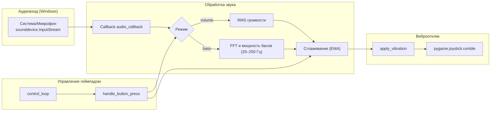

# voiceVibeControl

Приложение включает вибрацию на геймпаде в зависимости от уровня шума, считываемого с микрофона (или системного аудио при доступности loopback-устройства в Windows).

### 1. Структура проекта

```
  ├─ voiceVibeControl
  └─ README.md
```

### 2. Описание файлов

- **VibeControl.py**
  - **Назначение**: основной исполняемый модуль, реализующий захват аудио, анализ сигнала и управление вибрацией геймпада.
  - **Ключевые функции/классы**:
    - `class SimpleAudioVibrateController`:
      - `__init__()`: инициализация `pygame`, джойстика, параметров чувствительности/сглаживания и аудио-потока.
      - `setup_audio_stream()`: настройка входного аудио через `sounddevice.InputStream`; поиск loopback-устройств в Windows, фоллбэк на дефолтный микрофон.
      - `audio_callback(indata, frames, time, status)`: обработка аудио-буферов в реальном времени; вычисление интенсивности по громкости (RMS) или по басам (FFT), затем сглаживание.
      - `apply_vibration(intensity)`: преобразование интенсивности в параметры вибромоторов и вызов `joystick.rumble`.
      - `handle_button_press(button, pressed)`: обработка нажатий кнопок геймпада (переключение режима, изменение чувствительности, включение/выключение индикатора, выход).
      - `control_loop()`: цикл опроса событий геймпада.
      - `run()`: запуск аудио-потока и основного цикла управления.
      - `cleanup()`: корректная остановка и освобождение ресурсов.
    - `main()`: точка входа, создаёт контроллер и запускает его.
  - **Связи с другими файлами**: отсутствуют, модуль автономен.
  - **Краткое объяснение логики**: приложение захватывает аудио, оценивает интенсивность сигнала (RMS или мощность басов по FFT), сглаживает результат и маппит его в параметры вибромоторов геймпада через `pygame`.

### 3. Архитектура проекта

- **Общая структура**: монолитный модуль с одним основным классом-контроллером. Взаимодействие с системой ввода аудио через `sounddevice` (WASAPI/микрофон), управление вибрацией и кнопками — через `pygame`.
- **Потоки данных**:
  - Аудио-буферы поступают в `audio_callback` из `sounddevice.InputStream`.
  - В `audio_callback` вычисляется интенсивность сигнала: по режиму либо RMS (громкость), либо мощность басов (FFT 20–250 Гц). Затем применяется экспоненциальное сглаживание.
  - Интенсивность передаётся в `apply_vibration`, где рассчитываются параметры левого/правого моторов и вызывается `joystick.rumble`.
  - Параллельно `control_loop` опрашивает кнопки геймпада и обновляет режим и чувствительность.



### 4. Библиотеки/фреймворки

- **pygame**: инициализация геймпада, опрос кнопок, управление вибромоторами (`joystick.rumble`). Используется в `SimpleAudioVibrateController.__init__`, `control_loop`, `apply_vibration`, `cleanup`.
- **sounddevice**: захват входного аудио в реальном времени через `InputStream` и колбэк. Используется в `setup_audio_stream` и `audio_callback`.
- **numpy**: численные расчёты — RMS, FFT, агрегирование частотных диапазонов. Используется в `audio_callback`.
- (Импортированы также `threading`, `time`, `sys`, но в актуальной версии не используются напрямую.)

### 5. Точка входа и запуск

- **Точка входа**: функция `main()` в `VibeControl.py`, вызывается при запуске модуля напрямую (`if __name__ == "__main__":`).
- **Что выполняется первым**: создаётся `SimpleAudioVibrateController`, инициализируется джойстик и аудиопоток, затем запускается `run()`.

#### Быстрый старт (Windows, PowerShell)

```bash
python -m venv .venv
.venv\Scripts\Activate.ps1
pip install -U pip
pip install pygame sounddevice numpy
python VibeControl.py
```

Требования/заметки:
- Наличие геймпада с поддержкой вибрации (rumble) и совместимого драйвера.
- Разрешение на доступ к микрофону в системе.
- В Windows при наличии loopback-устройств (Stereo Mix/What U Hear/etc.) поток может быть направлен с системного аудио, иначе используется дефолтный микрофон.

### 6. Архитектурные особенности

- **Простая однопоточная архитектура с колбэком**: `sounddevice` вызывает `audio_callback` в реальном времени, а отдельный цикл `control_loop` опрашивает кнопки. Это упрощает синхронизацию и снижает задержки.
- **Два режима анализа**: RMS (обобщённая громкость) и FFT-басы (20–250 Гц) для акцента на низких частотах. Позволяет подстраивать тип виброотклика под контент.
- **Экспоненциальное сглаживание (EMA)**: уменьшает дрожание интенсивности и делает вибрацию стабильнее.
- **Защитный порог и ограничение интенсивности**: минимальный порог исключает шумы, а `min/max` ограничивает амплитуду для комфортной вибрации.
- **Фоллбэк аудиовхода**: попытка выбрать loopback-источник, иначе дефолтный микрофон — повышает совместимость без ручной настройки.

### 7. Дополнительно

- **Нестандартные решения**: прямое управление `rumble` из аудио-колбэка для минимальной задержки; гибкое переключение режимов по кнопкам геймпада без GUI.
- **Причины выбора архитектуры**: минимальная зависимость от внешних сервисов, низкая задержка, простая установка и кросс-библиотечная поддержка аудио/джойстика.

---

Автор: legenda  
Telegram: [@LEGENDA_SD](https://t.me/LEGENDA_SD)
